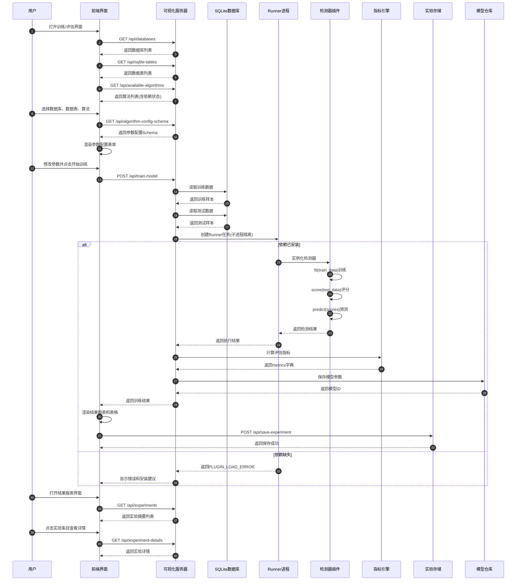

# 评估系统业务流程

## 时序图



## 业务流程详解

### 一、启动阶段

| 步骤 | 操作 | 说明 |
|------|------|------|
| 1 | 用户打开界面 | 访问训练评估界面 |
| 2-3 | 获取数据库列表 | 列出datasets目录下所有SQLite文件 |
| 4-5 | 获取数据表列表 | 根据数据库动态获取表 |
| 6 | 获取算法列表 | 返回内置+导入算法，含依赖状态 |

### 二、配置阶段

| 步骤 | 操作 | 说明 |
|------|------|------|
| 7 | 用户选择配置 | 选择数据库、数据表、算法 |
| 8-9 | 获取参数Schema | 从configs/detectors读取配置 |
| 10 | 渲染参数表单 | 动态生成输入控件 |

### 三、执行阶段

| 步骤 | 操作 | 说明 |
|------|------|------|
| 11 | 用户启动训练 | 点击按钮，收集参数 |
| 12 | 发送训练请求 | POST /api/train-model |
| 13-14 | 数据准备 | 读取训练集和测试集数据 |
| 15 | 创建Runner任务 | 在独立子进程中执行 |
| 16-19 | 检测器执行 | 训练→评分→预测 |
| 20 | 返回执行结果 | 包含异常分数、预测标签、阈值 |
| 21-22 | 指标计算 | 计算评估指标 |

### 四、结果处理阶段

| 步骤 | 操作 | 说明 |
|------|------|------|
| 23-24 | 模型保存 | 保存到models目录 |
| 25 | 返回结果 | 前端展示训练结果 |
| 26-27 | 结果可视化 | 渲染图表和表格 |
| 28-30 | 模型发布 | 可选发布到模型仓库 |
| 31-33 | 实验保存 | 自动保存实验记录 |
| 34-37 | 报表查看 | 查看历史实验 |

## 核心组件说明

### 1. 前端界面 (web/visualization/runner.js)
- 负责用户交互和结果展示
- 动态加载算法参数配置
- 实时显示依赖状态

### 2. 可视化服务器 (scripts/visualization_server.py)
- REST API服务
- 数据库查询代理
- 实验管理

### 3. Runner进程 (runner/runner_entry.py)
- 子进程隔离执行
- 超时控制
- 日志收集

### 4. 检测器插件 (detectors/*.py)
- 实现统一接口(fit/score/predict)
- 支持动态加载

### 5. 指标引擎 (evaluator/metrics_engine.py)
- 统一指标计算
- 支持多种评估指标

### 6. 实验存储
- outputs/experiment_*/reports/summary.json - 结果摘要
- configs/experiments/experiment_*.json - 配置记录

## 关键特性

### 1. 依赖检测机制
- 前端显示依赖状态图标
- 依赖缺失时提示安装命令
- 运行时检测并返回详细错误

### 2. 参数配置系统
- YAML配置文件驱动
- 自动推断参数类型
- 动态表单渲染

### 3. 执行隔离
- 子进程运行算法
- 超时保护
- 异常捕获

### 4. 模型版本管理
- 支持模型发布/复用
- 版本号管理
- 实验可复现

## 数据流转

```
用户输入 → 前端配置 → API请求 → 数据读取 → Runner执行 →
指标计算 → 模型保存 → 结果返回 → 前端展示 → 实验归档
```

## 验证清单

- 算法依赖状态显示
- 参数配置支持
- 两种评估模式
- 子进程隔离执行
- 完整指标计算
- 模型版本管理
- 实验自动保存
